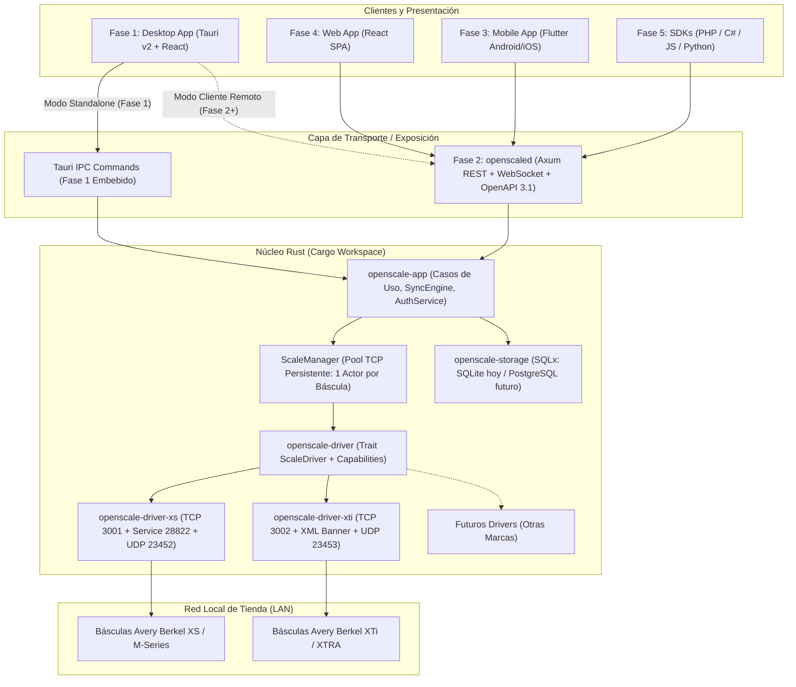

# OpenScale — Plan Maestro de Arquitectura e Implementación

> **Propósito:** Suite Open Source (**Apache-2.0**) multiplataforma para administrar, integrar y diagnosticar básculas **Avery Berkel** (Series **XS/M-Series** y **XTi/XTRA**), diseñada con arquitectura modular para escalar a gestión multi-sucursal (Cloud + Agente Local) y futuras marcas de básculas.
>
> **Especificaciones de protocolo en este repositorio:**
> - [Protocolo XS / M-Series](./protocolo-xs-mseries.md) (TCP `3001`, `XsServicePort` TCP `28822`, UDP `23452`)
> - [Protocolo XTi / XTRA](./protocolo-xti-xtra.md) (TCP `3002`, UDP `23453`)

---

## 1. Decisiones Arquitectónicas Cerradas (ADRs)

| # | Área | Decisión | Justificación y Ruta de Evolución |
|---|---|---|---|
| **ADR-01** | **Arquitectura Global** | **Core embebido en Fase 1 (Tauri IPC) → Daemon/API `openscaled` en Fase 2 (Axum)**, preparado para evolucionar a **Cloud + Agente Local** | Evita puertos locales o procesos sidecar en Fase 1. Toda la lógica de negocio, pool TCP y base de datos vive en crates Rust puros (`openscale-app`) desacoplados de Tauri y Axum. En Fase 2 se expone vía HTTP/WebSocket y el mismo daemon servirá a futuro como *Agente Local* multi-sucursal. |
| **ADR-02** | **Persistencia** | **Catálogo Maestro local en SQLite (WAL) vía `SQLx`** + operación en vivo opcional | Leer ~800 PLUs en vivo sobre XS toma ~18 s. SQLite embebido ofrece UI instantánea, *delta sync* a N básculas, respaldos y clonación sin instalar motores externos. Diseñado con `SQLx`, `store_id`, UUIDv7 y `sync_version` para migrar limpiamente a **PostgreSQL** en escenarios multi-sucursal. |
| **ADR-03** | **Stack Core & Desktop** | **Rust (Tokio + SQLx + Axum) + Tauri v2 + TypeScript + React** | Control seguro y determinista sobre tramas binarias Big-Endian/Little-Endian, buffers de 500 B y cifrado de flujo (`28822`). Binarios nativos ligeros (~15–25 MB), multiplataforma (**Windows 10/11, macOS, Linux x64 y ARM/Raspberry Pi**) y reutilización de UI entre Desktop y Web. |
| **ADR-04** | **App Móvil (Fase 3)** | **Flutter (Android & iOS)** | Mejor experiencia de usuario y rendimiento real en piso de tienda: compilación AOT + motor gráfico Impeller (60/120 fps sin puente JS), fluidez superior en teléfonos Android económicos y terminales industriales (Zebra/Honeywell), escáner de cámara y caché offline. Consume el contrato OpenAPI de `openscaled` (y a futuro puede embeber `openscale-core` con `flutter_rust_bridge`). |
| **ADR-05** | **SDKs (Fase 5)** | **Fase 5a: Clientes HTTP/WS generados desde OpenAPI 3.1** (PHP, C#, JS/TS, Python). **Fase 5b (opcional): Bindings nativos `openscale-ffi` (UniFFI/C-ABI)** | Resuelve el problema de PHP (sin sockets TCP persistentes, evitaría bloqueos en puerto `3001` de XS) y mantiene paridad entre lenguajes. El core Rust permite publicar bindings nativos embebibles a futuro sin reescribir protocolos. |
| **ADR-06** | **Licencia Open Source** | **Apache-2.0** (toda la suite y SDKs) | Permite adopción comercial y comunitaria sin fricción, incluye cláusula explícita de patentes y evita conflictos de licencia si se exponen bindings FFI del Core Rust hacia los SDKs. |
| **ADR-07** | **Estructura de Repos** | **Monorepo** (`OpenScale`: Core + Desktop + API + Web + Mobile) + **Repos separados por SDK** en Fase 5 | Un solo PR mantiene sincronizados protocolo, esquema de BD, API, tipos y UI. Los SDKs en repos independientes (`openscale-php`, `openscale-dotnet`, `openscale-js`, `openscale-python`) facilitan publicación en Packagist, NuGet, npm y PyPI. |
| **ADR-08** | **Seguridad y Roles** | **Roles locales + API Keys desde el día 1**, con *Single-User Mode* opcional en escritorio local y **autenticación obligatoria** al exponer la API en red | Protege acciones sensibles (`#748 Scale Settings`, cambio de IP, borrado masivo, reinicio) sin añadir fricción al usuario individual local. |
| **ADR-09** | **Internacionalización** | **Inglés (`en`) + Español (`es`) desde el día 1** | Estándar para proyectos Open Source globales; implementado desde el arranque con `i18next` (Desktop/Web) y ARB/l10n (Flutter). |
| **ADR-10** | **Pruebas y Hardware** | **Tests unitarios de protocolo deterministas en CI + Pruebas de integración contra básculas físicas XS y XTi** | Sin simulador TCP/UDP completo: se validan tramas byte a byte con fixtures reales en CI y se ejecutan pruebas de integración opt-in no destructivas contra hardware físico XS y XTi. |

---

## 2. Arquitectura de Alto Nivel



### Patrón `OpenScaleTransport` (Reutilización 100% UI entre Desktop y Web)
En `packages/client`, toda la capa de hooks y pantallas consume la interfaz `OpenScaleTransport`:
- **Fase 1 (Desktop Standalone):** inyecta `TauriIpcTransport` (`invoke` + eventos nativos de Tauri).
- **Fase 2 (Desktop Modo Remoto) y Fase 4 (Web App):** inyecta `HttpWsTransport` (REST + WebSockets contra `openscaled`).

---

## 3. Estructura del Monorepo

```text
OpenScale/
├── Cargo.toml                     # Cargo Workspace raíz
├── package.json                   # pnpm Workspace raíz
├── pnpm-workspace.yaml
├── LICENSE                        # Apache-2.0
├── docs/                          # Protocolos validados, plan de arquitectura, guías
│   ├── plan-implementacion.md
│   ├── protocolo-xs-mseries.md
│   └── protocolo-xti-xtra.md
├── crates/
│   ├── openscale-domain/          # Modelos puros, tipos nuevos (PluKey, MoneyCents), errores, store_id
│   ├── openscale-driver/          # Trait ScaleDriver, DriverCapabilities, eventos de conexión
│   ├── openscale-driver-xs/       # MSeriesProtocol (3001), XsServicePort (28822), UDP 23452
│   ├── openscale-driver-xti/      # XtraDataPort (3002), Banner XML, SQLW, UDP 23453
│   ├── openscale-storage/         # SQLx (SQLite WAL), migraciones, repositorios, auditoría, sync_state
│   ├── openscale-app/             # Servicios: ScaleManager, SyncEngine, Catalog, Totals, ServiceConsole, Auth
│   └── openscale-api/             # (Fase 2) Router Axum, OpenAPI 3.1 (utoipa), WebSockets, Auth middleware
├── apps/
│   ├── desktop/                   # (Fase 1) App Tauri v2 (src-tauri + entrada React)
│   ├── daemon/                    # (Fase 2) Binario openscaled (Windows Service / systemd / launchd / Docker)
│   ├── mobile/                    # (Fase 3) App Flutter (Android & iOS)
│   └── web/                       # (Fase 4) Entrada Web SPA (reutiliza packages/ui + HttpWsTransport)
├── packages/
│   ├── client/                    # Tipos TS, interfaz OpenScaleTransport (IPC + HTTP/WS)
│   ├── ui/                        # Design system, pantallas compartidas, tablas virtuales, diseñador etiquetas
│   └── i18n/                      # Diccionarios locales/en.json y locales/es.json
└── scripts/                       # Prototipos PowerShell validados (referencia viva)
```

**Repositorios independientes en Fase 5 (sincronizados vía GitHub Actions desde `openapi.yaml`):**
- `openscale-php` (Packagist / Composer)
- `openscale-dotnet` (NuGet)
- `openscale-js` (npm — TypeScript nativo)
- `openscale-python` (PyPI — sync + `asyncio`)

---

## 4. Diseño Técnico del Núcleo Rust

### 4.1. `ScaleManager` (Patrón Actor por Báscula)
- Cada báscula registrada ejecuta **un Tokio Task (Actor) dedicado**, dueño exclusivo de sus sockets TCP (`3001` y opcionalmente `28822` en XS; `3002` en XTi), procesando comandos por cola priorizada (`mpsc`).
- **Reglas críticas en `openscale-driver-xs`:**
  - `TCP_NODELAY = true`, `KeepAlive = true`, **sesión TCP persistente** con reconexión con *backoff* exponencial.
  - Escritura atómica obligatoria: cabecera `ABcmdheader` (51 B) + payload (máx. 500 B por bloque) concatenados en un único buffer y enviados en **una sola llamada `write_all()`**.
  - Codificación `Windows-1252` (`encoding_rs`) y Big-Endian (`bytes::Buf` / `BufMut`).
  - Preservación de bytes reservados en `PLU_RECORD` (`rec[0x4F..0x50]`) y `MACHINE_PARAMETERS` (lectura previa → parcheo → escritura de los 80 B completos).
  - Conteo rápido `O(log N)` mediante búsqueda exponencial + binaria sobre `SearchIndex` en `PLU_RECORD` y `PLU_TOTALS`.
  - Cifrado de flujo simétrico de 10 bytes en `XsServicePort` (`28822`), reiniciando el estado por mensaje.
- **Reglas críticas en `openscale-driver-xti`:**
  - Lectura inmediata del **Banner XML** (`uint64 LE` + UTF-8) al abrir el socket `3002`.
  - Serialización `MxApiOutputStream` (Metadata Map sin prefijo total + Payload Map **con prefijo `uint64 LE` de tamaño interno**) y lectura de `ResponseBatch`.
  - Diferencias semánticas manejadas por el driver: `DID` inicia en `1`, `CTV` tara directa en gramos, `GPTA1..12` + `DBT`, cambio de precio seguro vía `READONE` → actualizar `P1`/`P2FS` → `WRITE`, filtros `SQLW` y soporte preparado para `Authenticate = Yes`.

### 4.2. Capacidades Declarativas (`DriverCapabilities`)
Cada driver declara sus capacidades para evitar condicionales por modelo en la UI y la API:
- `supports_fast_price_change` (`true` en XS `CMD=5`; `false` en XTi → usa `READONE+WRITE`)
- `supports_service_port` (`true` en XS `28822`)
- `supports_live_weight` / `supports_lcd_mirror` / `supports_remote_keys`
- `supports_sql_filter` (`true` en XTi `SQLW`)
- `did_range` (`0..=99` en XS; `1..=999999` en XTi), `plu_max_digits` (`13` vs `14`), `text_areas_count` (`6` vs `12`)
- `tare_mode` (`TableReference(CID)` en XS vs `DirectGrams(CTV)` en XTi)

### 4.3. Esquema de Base de Datos y `SyncEngine`
- **Preparado para multi-sucursal:** todas las entidades llevan `id` (UUIDv7), `store_id` (default local), `sync_version`, `updated_at` y `deleted_at` (soft delete).
- **Tablas principales:** `stores`, `scales`, `scale_groups`, `departments`, `plus`, `tares`, `tax_rates`, `stored_texts`, `media_assets`, `barcode_formats`, `label_formats`, `sales_snapshots`, `sync_jobs`, `sync_job_items`, `scale_plu_checksums`, `users`, `api_keys`, `audit_logs`.
- **Delta Sync:** cada PLU mantiene un hash determinista; al sincronizar un grupo de básculas, `SyncEngine` envía solo altas, modificaciones (usando `CHANGE_PRICE` en XS si únicamente cambió el precio) y bajas, con progreso en vivo y reintentos ante desconexiones.

### 4.4. Seguridad, Roles y Auditoría

| Rol | Permisos Principales |
|---|---|
| **`Viewer`** | Ver inventario de básculas, catálogo, estado de red y reportes de ventas (solo lectura). |
| **`Operator`** | `Viewer` + crear/editar PLUs, cambio rápido de precios, importar CSV/Excel y lanzar sincronizaciones. |
| **`Admin`** | `Operator` + tablas maestras, formatos de etiquetas/códigos de barras, gestión de básculas, usuarios y API Keys. |
| **`Technician`** | Consola de Servicio (`XsServicePort` `28822`), `#748 Scale Settings`, configuración de red/IP, LCD/teclado remoto, diagnóstico y reinicio. |

- **Modo Single-User Local (Desktop Fase 1):** activo por defecto en local para trabajar sin fricción; activable/desactivable desde Configuración.
- **Regla estricta en red (Fase 2+):** al escuchar en red (`0.0.0.0` o IP LAN) en `openscaled`, el modo sin autenticación queda bloqueado; toda petición requiere JWT o `X-API-Key` (almacenada como hash SHA-256 con prefijo `osk_...` y scopes).

---

## 5. Roadmap Detallado por Fases

### Fase 0 — Fundación del Monorepo y Cimientos
- [x] Inicializar Cargo Workspace + pnpm Workspace + licencia **Apache-2.0** + `README.md` / `CONTRIBUTING.md`.
- [x] Crear `openscale-domain`, `openscale-driver` y `openscale-storage` (SQLx SQLite WAL + migración `0001_init.sql`).
- [x] Configurar `packages/i18n` (`en` + `es`), `packages/client` (`OpenScaleTransport`) y `packages/ui` (React + Vite + Tailwind + shadcn/ui + TanStack Table/Query).
- [x] Configurar CI en GitHub Actions (`cargo test`, `cargo clippy`, `pnpm typecheck`, builds Windows/macOS/Linux x64+ARM64).

---

### Fase 1 — Aplicación de Escritorio (Prioridad #1, Tauri v2 + React)

#### Hito `v0.1` — Núcleo Comercial (MVP Funcional)
- [ ] **Drivers XS y XTi base:** Descubrimiento LAN simultáneo (UDP `23452` + `23453` + unicast por rango), handshake (`VERSION_DETAILS`/`ASSETINFO`/`MACHNETCONFIG` en XS; Banner XML + `PING` en XTi), fecha/hora, CRUD de PLUs, conteo rápido `O(log N)` en XS y cambio rápido de precios.
- [ ] **Validación física XTi:** probar y ajustar `openscale-driver-xti` contra báscula XTi real y actualizar [protocolo-xti-xtra.md](./protocolo-xti-xtra.md).
- [ ] **`ScaleManager`:** pool TCP persistente por báscula, reconexión automática, monitor online/offline y cola de comandos.
- [ ] **Catálogo Maestro + CRUD PLUs:** tabla virtualizada para miles de PLUs, filtros, edición masiva de precios e importación/exportación **CSV y Excel (`.xlsx`)**.
- [ ] **Motor de Sincronización:** importar catálogo desde báscula física hacia SQLite, *Delta Sync* / *Full Sync* hacia 1 o N básculas con barra de progreso, respaldo y clonación.
- [ ] **UI Base:** layout responsive, tema claro/oscuro, selector EN/ES, roles locales (con Single-User Mode opcional) y logs de actividad.

#### Hito `v0.2` — Tablas Maestras + Ventas y Reportes
- [ ] **Tablas Maestras:** CRUD y sincronización de Departamentos, Taras/Contenedores, Impuestos, Textos/Leyendas, Logos/Media BMP y Formatos de Códigos de Barras (`BARCODE_FORMATS`).
- [ ] **Ventas y Reportes:** lectura de `GRAND_TOTALS`, `DEPT_TOTALS`, `GROUP_TOTALS`, `OPERATOR_TOTALS`, `MACH_TOTALS` y `PLU_TOTALS` (períodos 0 y 1), historial de *snapshots* en SQLite, gráficas y exportación CSV/Excel/PDF.

#### Hito `v0.3` — Consola de Servicio Técnico + Respaldo de Etiquetas
- [ ] **`XsServicePort` (`28822`):** peso en vivo, balance/tara remota, editor legible de `#748 Scale Settings`, lectura de memoria/pools, logs de diagnóstico (`SYSTEM`/`COMMS`/`KEYBOARD`), impresión de prueba, cajón y reinicio remoto.
- [ ] **Espejo LCD + Teclado Remoto:** render en vivo del bitmap `320×128` (1 bpp) y envío de `WRITE_KEYSTROKE`.
- [ ] **`MACHINE_PARAMETERS` (`CMD=24`):** editor seguro (lectura previa de 80 B → edición → escritura completa).
- [ ] **Gestión de `LABEL_FORMATS`:** lectura de `PFID 0..99`, listado de campos, respaldo JSON/binario y clonación entre básculas.

#### Hito `v1.0` — Diseñador Visual de Etiquetas (WYSIWYG)
- [ ] **Editor Canvas drag-and-drop:** regla en mm (conversión a décimas de mm `X1,Y1,X2,Y2` y `FW` en centésimas de mm), 50 slots de campo (`FT`), rotación `0°/90°/180°/270°` y vista previa de fuentes ABML.
- [ ] **Validación e impresión:** control de límites de `898 B`, vista previa con un PLU real, envío a báscula e impresión de prueba.
- [ ] **Releases `v1.0`:** instaladores para Windows (`.msi`/`.exe`), macOS (`.dmg`) y Linux (`.AppImage`/`.deb`).

---

### Fase 2 — API Pública (`openscaled` — Axum + OpenAPI 3.1)
- [ ] Crear `crates/openscale-api` + binario `apps/daemon` (`openscaled`) reutilizando `openscale-app`.
- [ ] **REST v1 (`/api/v1/...`) + WebSockets (`/api/v1/ws`):** endpoints completos + eventos en tiempo real (estado, progreso de sync, peso en vivo, frames LCD).
- [ ] **OpenAPI 3.1 (`utoipa`):** generación automática de `openapi.yaml` + UI interactiva (Scalar/Swagger) en `/docs`.
- [ ] **Seguridad de red:** JWT + API Keys con scopes, CORS, rate limiting y soporte TLS.
- [ ] **Despliegue:** Windows Service, `systemd` (Linux x64/ARM/Raspberry Pi), `launchd` (macOS) y Docker multi-arch (`amd64`/`arm64`/`arm/v7`).
- [ ] **Desktop Modo Remoto:** habilitar `HttpWsTransport` en Desktop para conectarse opcionalmente a un `openscaled` en LAN.

---

### Fase 3 — Aplicación Móvil (Flutter — Android & iOS)
- [ ] Proyecto Flutter en `apps/mobile` con cliente generado desde `openapi.yaml`, EN/ES y caché offline SQLite.
- [ ] Vinculación por código QR con `openscaled`, escáner de códigos de barras con cámara para edición rápida de precios, monitoreo de básculas en tiempo real, resumen de ventas y consola técnica móvil.

---

### Fase 4 — Web App (React + TypeScript)
- [ ] Proyecto `apps/web` reutilizando `packages/ui`, `packages/client` (`HttpWsTransport`) y `packages/i18n`.
- [ ] Despliegue embebido en `openscaled` (acceso desde cualquier navegador en LAN sin instalar nada) y preparación multi-sucursal (`store_id`) como puente hacia Cloud + Agente Local.

---

### Fase 5 — SDKs para Desarrolladores (PHP, C#, JS/TS, Python)
- **Fase 5a — SDKs Oficiales de la API (repos separados, Apache-2.0):**
  - `openscale-js` (npm), `openscale-python` (PyPI), `openscale-php` (Packagist), `openscale-dotnet` (NuGet), generados desde `openapi.yaml` + capa ergonómica idiomática y ejemplos listos para usar.
- **Fase 5b — Evolución Opcional (SDK Nativo Embebible):**
  - Crate `openscale-ffi` (UniFFI / C-ABI) exponiendo los drivers Rust directamente para integradores sin daemon.

---

## 6. Estrategia de Pruebas con Hardware Real (XS y XTi)

1. **Nivel 1 — Tests Unitarios (CI en cada PR, sin hardware):**
   - Verificación byte a byte de `ABcmdheader`, `PluKey`, `PLU_RECORD`, `CHANGE_PRICE`, `LABEL_FORMATS`, cifrado `XsServicePort`, Banner XML de XTi y framing `uint64 LE`.
   - Tests de `SyncEngine`, *delta hashing*, migraciones `SQLx` y permisos RBAC en SQLite en memoria.
2. **Nivel 2 — Tests de Integración con Básculas Físicas (opt-in local):**
   - Activados mediante `OPENSCALE_TEST_XS_IP` y `OPENSCALE_TEST_XTI_IP`.
   - **Política no destructiva:** escrituras restringidas a un PLU de prueba reservado (configurable por env var) o patrón *leer original → modificar → verificar → restaurar original*.

---

## 7. Prerrequisitos en la Máquina de Desarrollo (Para Continuar)

### Windows 10 / 11
```powershell
winget install -e --id Git.Git
winget install -e --id OpenJS.NodeJS.LTS
winget install -e --id Microsoft.VisualStudio.2022.BuildTools --override "--wait --quiet --add Microsoft.VisualStudio.Workload.VCTools --includeRecommended"
winget install -e --id Rustlang.Rustup
```
*(En una terminal nueva: `corepack enable pnpm` y verificar que Microsoft Edge WebView2 esté instalado.)*

### macOS
```bash
xcode-select --install
curl --proto '=https' --tlsv1.2 -sSf https://sh.rustup.rs | sh
brew install node pnpm
```

### Linux (Ubuntu / Debian)
```bash
sudo apt update && sudo apt install -y build-essential curl wget file libssl-dev libgtk-3-dev libayatana-appindicator3-dev librsvg2-dev libwebkit2gtk-4.1-dev
curl --proto '=https' --tlsv1.2 -sSf https://sh.rustup.rs | sh
corepack enable pnpm
```

### Checklist de Arranque al Retomar (Fase 0 + Sprint 1)
1. Verificar toolchain (`rustc --version`, `cargo --version`, `node --version`, `pnpm --version`, `git --version`).
2. Inicializar repositorio Git, licencia **Apache-2.0**, `Cargo.toml` (workspace) y `pnpm-workspace.yaml`.
3. Implementar `openscale-domain`, `openscale-driver`, `openscale-driver-xs` y `openscale-driver-xti` (descubrimiento UDP + handshake + CRUD básico de PLUs).
4. Validar en vivo contra las básculas físicas XS y XTi.
5. Levantar el cascarón de la App de Escritorio Tauri v2 + React (EN/ES) conectada por IPC mostrando el descubrimiento y listado de básculas en vivo.
